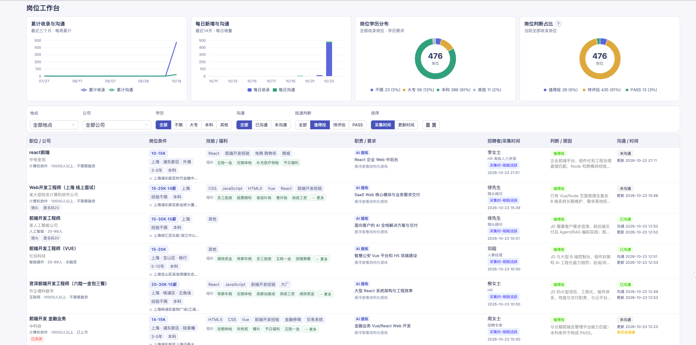

# Findwork

*AI 智能求职工作台 · 筛选更合适的岗位，把有限的投递机会留给值得争取的工作。*

### 工作台预览

真实岗位工作台截图，包含四张 ECharts 图表、岗位筛选、岗位判断与沟通记录；数据是截图时的状态，以本地数据库实时结果为准。

### 如何使用

把下面的链接直接发给**有本机操作能力的 AI 助手**。AI 会主动检查环境、准备项目、配置求职策略并完成首次岗位采集与评估；只有账号登录、个人信息确认和对外沟通授权需要你参与。

**[https://github.com/sayhelloproton-eng/findwork/blob/main/GETTING_STARTED.md](https://github.com/sayhelloproton-eng/findwork/blob/main/GETTING_STARTED.md)**

### 项目简介

Findwork 利用用户在招聘平台设置的**岗位期望**完成初筛，再由 AI 根据**个人画像、求职偏好、排除条件**进一步评估。岗位数据和处理记录保存在本地，减少重复查看和无效沟通。

### 工作流程

| 环节 | 作用 |
| --- | --- |
| 岗位期望初筛 | 获取符合目标方向的岗位列表和详情 |
| 入库与去重 | 保留已有记录，避免重复评估和重复沟通 |
| AI 二次评估 | 区分值得争取、不考虑和待确认的岗位 |
| 授权沟通 | 按匹配度排序，经用户确认后使用原平台功能 |
| 本地工作台 | 查看岗位、评估状态和实际操作记录 |

### 使用边界

- **用户自主决策**：AI 辅助筛选，不会仅凭评估结果擅自发送消息；沟通与正式简历投递分别记录。
- **个人数据留在本地**：简历画像、求职策略、岗位数据库及沟通记录不包含在公开仓库中。
- **逐步接入平台**：目前支持一个招聘平台的采集与授权沟通，其他平台尚需接入；不负责投递后的聊天和面试跟进。

[架构说明](./docs/DESIGN.md) · [MIT 许可](./LICENSE) · [项目声明](./DISCLAIMER.md) · [隐私说明](./PRIVACY.md) · [安全反馈](./SECURITY.md) · [参与贡献](./CONTRIBUTING.md)
