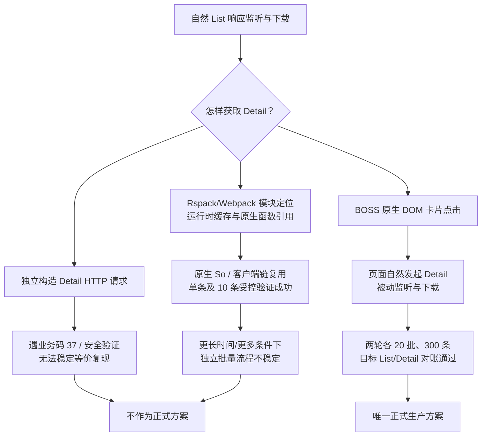

# BOSS 职位助手｜当前方案、历史取舍和改进建议

本文件是**唯一活动工程方案**，同时给贡献者和 AI 阅读。历史部分用于理解失败与成功的选择，**不是旧操作入口**。使用方法参见 [README](../README.md) 和扩展 Skill。

## 1. 当前设计原则

- **唯一正式 Detail**：按自然 List 的职位 ID 唯一定位真实 DOM 卡片，点击后只保存网页自然产生的响应。不额外构造 Detail HTTP、不绕过平台风控。
- **边界只到下载文件**：扩展仅依赖 Chrome Storage（运行状态与回执）及 Chrome Downloads（JSON 文件）；不直接读写 SQLite，不调用外部 Web/后端数据库，不依赖 Findwork 主应用配置。
- **严格实际证据**：每批 List、每条 Detail 都要求自然响应、职位 ID 对账与 Chrome COMPLETE；阶段日志和页面 ACK 不等于成功。
- **独立授权沟通**：Greet 是另一个真实对外动作，不参加 Detail 编排，用户逐职位授权，UNKNOWN 不补发。

## 2. 目录与所有者

| 入口 / 模块 | 唯一责任 | 禁止越界 |
|---|---|---|
| `manifest.json` / `auto-entry.js` | 声明权限、装配 Service Worker | 业务编排、数据库 |
| `core/network/` | MAIN Hook 和 List/Detail allowlist，观察自然 fetch/XHR | 额外 HTTP 或 UI 点击 |
| `core/capture/page-observer.js` | MAIN → ISOLATED 桥，docId/requestId、自然响应 Inbox | 主动请求、SQLite |
| `core/capture/hook-recovery.js` | 扩展 Reload 后的 Hook/Observer 握手 | 假造业务成功 |
| `core/capture/auto-download.js` | List 时间窗口、授权下载、回执恢复 | Detail、数据库 |
| `actions/detail/dom-native-store.js` | 自然 Detail 接收、下载、按 jobId 记录回执 | 主动发送 Detail 请求 |
| `actions/detail/dom.js` | 自动 Refresh → DOM Detail → Scroll 编排、Fresh/Resume 与终态 | SQLite、求职策略 |
| `actions/refresh/` / `actions/scroll/` | 单个浏览器动作与目标 Tab 验证 | 代替总编排器 |
| `core/shared/action-event-router.js` | Refresh/Scroll 消息身份、List 下载门控 | 直接写 DB |
| `actions/greet/` | 串行沟通、结果下载、失败暂停、UNKNOWN 防重发 | 自动投递或替代采集 |
| `actions/detail/diagnose.html` | 统一只读观察页面结构、滚动几何、Hook 与采集回执 | 触发页面动作、导出完整 DOM |
| `diagnostics/greet-status.html` | 旧链接兼容，跳转到默认 Greet 页 | 独立观察或操作队列 |

完整数据流：

    网站自然 List/Detail
      → MAIN Hook（被动观察）
      → ISOLATED Observer（身份校验与持久 Inbox）
      → Service Worker（按类型下载/回执）
      → Chrome Downloads/BOSS/YYYY-MM-DD/
      → [扩展完成]
      → 任何可选外部消费者（独立程序或数据库）

唯一自动入口：`actions/detail/dom.html?auto=1&expect=N&pages=P`。每批 15 条；首条自然详情不重复点击；后续依 encryptJobId 而非 DOM 位置找卡片，15/15 后才 Scroll。`fresh=1` 不复用上轮 Detail COMPLETE，安全终态才能开启。

## 3. 数据、状态与文件合同

List 保存完整接口 JSON，目标身份是 `zpData.jobList[*].encryptJobId`。Detail 保存 `contract=boss-natural-detail.v1`、`jobId`、`capturedAt`、`rawResponse`；对应 `rawResponse.zpData.jobInfo.encryptId`，业务码 0 且 `postDescription` 非空。

Chrome 下载根目录中的 `BOSS/YYYY-MM-DD/list/`、`detail/`、`greet/`、`diagnostics/` 按性质分离。扩展不会建 SQLite 表或自动导入，主求职系统的 CLI 只是可能的外部消费者，不能成为扩展的安装/验收前置。

状态严格分工：`boss-raw-event-gate-v1` 管 List 授权窗口；`boss-raw-downloads-v2` 管 List 下载回执；`boss-native-list-latest-v1` 管最近已下载 List；`boss-natural-detail-v1` 管 Detail 记录/恢复；`boss-dom-detail-sequence-v1` 管自动编排进度/终态；`boss-dom-fresh-last-v1` 只存最近运行摘要；`boss-greet-queue-v1` 只管独立沟通。日志用于诊断，不代表真实落盘。

## 4. 技术演进路线图与取舍

下面是**方案的技术验证结果与正式采用情况**，不是未经验证的成功宣称，也不是旧方案的可执行入口。

| 路线 | 技术价值 / 已验证证据 | 业务结果与定位 |
|---|---|---|
| 自然 List（Refresh / Scroll） | 每个自然列表接口响应独立记录并下载原始 JSON | **通过，仍为正式 List 层** |
| 独立构造 Detail 请求 | 可研究参数字段、请求时序、响应与安全状态 | **未稳定通过**；业务码 37 / 安全跳转，淘汰主动补采 |
| Rspack/Webpack → 模块索引 → 原生函数复用 | 识别模块 74778 / 97994、原生 So → ZV → Axios 链；受控单次和 10 条实验取得真实成功 | **技术可行、验证有价值；独立批量生产不稳定**。不能把后续风控等同于“技术完全失败” |
| DOM 按 jobId 点击 → 自然 Detail 响应 | 与真实网页行为一致，复用 MAIN Hook/Observer 的捕获链；两轮各 300 条真实验收 | **正式采用**。非目标自然 Detail 必须排除，不能凑数 |
| Chrome JSON → 外部程序 | 扩展只产生文件，开发者可用任意程序读 JSON | **插件交付边界**，不要求 SQLite / 求职后端 |

**明确区分两种“成功”：** Rspack 原生函数复用的单次和 10 条实验，证明过模块定位、函数引用与特定条件下请求复用技术有效；但不证明在所有页面状态、日期和批量情况下稳定、不受安全限制。DOM 自然请求路线则在 2026-10-23 两轮 300 条业务场景中通过了对账。两者既不互相否定，也不能混为同一验收。

## 5. 关键技术决策与后续建议

- **不删除技术知识**：历史 Rspack/模块缓存/导出、原生函数复用、字段来源及安全跳转判断，已在本节按可行性与失败边界凝练记录。详细阶段性原始材料仍可由项目 Git 提交历史按需查阅，但不会堆在公开文档里。
- **保持现行边界**：MAIN Hook 仅被动代理自然请求，ISOLATED Observer 只做事件传递，Worker 只管理下载和恢复，DOM 控制页负责流程，Greet 单独授权，数据库/AI 筛选属于外部系统。
- **Fresh 隔离**：Worker 的自然 Detail 记录带有 Fresh 运行 ID，Fresh 控制页使用相同运行 ID 查回执；不允许拿旧运行 ID 对应的 COMPLETE 充新任务完成。后续仍可在新的页面版本下增强请求级时间/文档 ID 关联。
- **诊断收口与最小权限**：采集使用 Diagnose，沟通观察与人工恢复收口到 Greet 同一页面，Greet Status 旧链接只跳转；Inspect/Scroll Geometry 的有用结构与尺寸数据已经并入 Diagnose，完整 DOM 导出移除；高权限网络诊断及 debugger/webRequest 均不在发行包。仍需新版 Chrome 真实验收。
- **发布前仍须做正式构建包的最小 Chrome 实测**：旧两轮 300 条不会自动变成新版构建的现场证明。不要为了审计重跑完整 300 条。
- **可选后续优化**：加强 Worker 重启 UNKNOWN 的合成回归，但不重新设计一个主动 Detail Queue 或将数据库引入扩展。

## 6. 使用、验证与隐私

开发者在扩展目录 `npm test`；`npm run verify` 包括正式构建，Chrome 从 `dist/boss-list-observer/` 加载。BOSS 账号需同一 Chrome Profile 登录，列表 Tab 唯一。`expect=0` 为推荐，其余期望顺序不固定；`pages` 为 1～21。验证码/限流/安全跳转或 UNKNOWN 必须停止，不得换直连或绕过扩展。

采集只读诊断使用 `actions/detail/diagnose.html`（Hook、页面结构、滚动几何、资源计数与回执），不导出完整 DOM。沟通统一使用 `actions/greet/greet.html`：带参数入队后关闭；不带参数展示队列、回执位置和人工提示。岗位不存在或开聊提醒保存失败并暂停，人工确认后仅继续剩余未发送任务；每日上限、安全校验、UNKNOWN 和回执未落盘不提供恢复。旧 `diagnostics/greet-status.html` 仅跳转到默认 Greet 页。

开源仓库不包含真实 JSON、Cookie、Token、securityId、lid、私有 SQLite、个人简历或沟通记录；示例只能是合成数据。安装包不包含私人历史下载。一次测试 PASS 不等于 Chrome 现场 PASS。

## 可选附件简历直投

`actions/greet/resume-delivery.js` 由Greet后台调用，无独立定时器或第二页面；同页resume-delivery-ui管理默认关闭开关、附件选择及独立结果。开关世代在入队时快照，关闭再打开不会激活旧意图。Greet成功及下载COMPLETE后才执行；模块设置/执行异常不能改写或暂停Greet。

重取同岗位Detail，检查canSendResume/alreadySend，原生exchange precheck type=3，附件checkbox选择，再POST onekeydeliver；需要确认、无附件、多份未选时不发送。Findwork场景还做独立只读resume资格检查。发送前持久化SENDING，重启时标UNKNOWN并阻止后续简历发送；无自动重试。独立application回执复用现有下载完成验证，不触碰Greet回执和额度。代码验证只使用合成数据，安装实例/实发另行验收。

1.1.25：Greet结算原子保存resumeTask=PENDING；bootstrap优先检查该交接，SENDING/RECEIPT_PENDING中断不重发。平台停止原因在等待文件前持久化，并传播回Greet；既有SUCCESS不回退。实际附件ID/名称保存在独立回执和阶段记录中。collection-launch只复用正式Detail页并按requestId幂等，不新增采集执行器；本地桥只承接用户按钮动作，拒绝运行中/未结算/多控制页。
